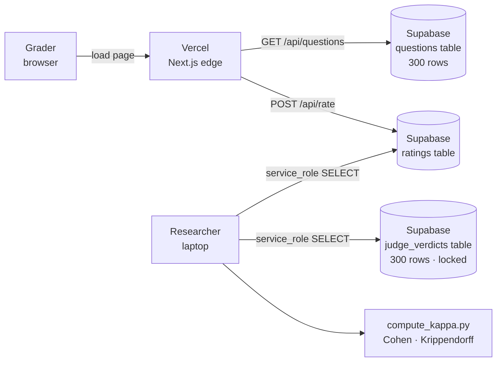
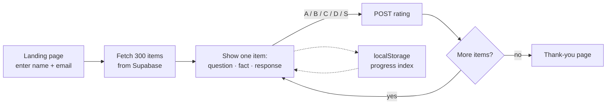
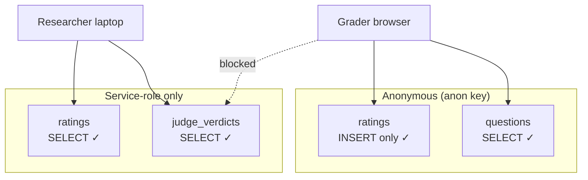

# BurnettBench — Human Validation App

Minimal Next.js app for collecting human verdicts to validate the GPT-4o-mini judge used in
**BurnettBench Study 2 — Scope Coverage Effects in llms.txt V2** (Niyorurema & Estella, 2026).

Live: **https://burnettbench-grader.vercel.app**

Zero backend to maintain. Static frontend on Vercel, three tables on Supabase, one Python script
on your laptop to compute κ.

---

## Architecture



- Graders only ever see the 300 **questions** and write back **ratings**.
- The **judge_verdicts** table is service-role-only — graders cannot see what the LLM judge said, so they rate blind.
- κ computation runs locally on the researcher's laptop, pulling both tables with the service key.

## What a grader experiences



Each item asks for a 3-way verdict (A = correct, B = confidently wrong, C = not addressed) with
a fourth option (D = flag ground truth) and a skip. Keyboard shortcuts: `a` `b` `c` `d` `s`.
Progress is saved in `localStorage` so graders can pause and resume on the same device.

## Access model



Three Supabase RLS policies make this work:
- `questions`: `select` for `anon` (public catalog)
- `ratings`: `insert` for `anon`, no `select` (write-only drop box)
- `judge_verdicts`: no `anon` policy at all → fully locked

## Repository layout

```
burnettbench-grader/
├── app/
│   ├── page.tsx              ← landing / name entry
│   ├── grade/page.tsx        ← grading UI
│   ├── done/page.tsx         ← completion screen
│   ├── globals.css           ← Vignelli-style B/W + accent colors
│   └── api/
│       ├── questions/route.ts ← GET: fetch 300 items from Supabase
│       └── rate/route.ts      ← POST: insert rating into Supabase
├── analysis/
│   └── compute_kappa.py       ← Cohen's κ + Krippendorff's α
├── supabase/
│   └── schema.sql             ← schema + RLS policies
├── private/                   ← local-only; judge verdicts for κ (gitignored)
└── data/                      ← local-only; dev fallback ratings file (gitignored)
```

## Local dev

```bash
cd burnettbench-grader
npm install
cp .env.example .env.local
# edit .env.local with your Supabase URL + anon key
npm run dev
```

Open http://localhost:3000. If `NEXT_PUBLIC_SUPABASE_URL` is a placeholder, ratings fall back to
`data/ratings.jsonl` (dev convenience). With real Supabase env vars, they go to the DB.

## Fresh Supabase setup (if cloning into a new project)

1. Create a project at https://supabase.com/dashboard.
2. SQL Editor → paste [`supabase/schema.sql`](supabase/schema.sql) → Run.
3. Settings → API → copy **Project URL** and **anon public** key into `.env.local`.
4. Also note the **service_role** key for the κ script (stays local, never commit).

## Deploy to Vercel

Already deployed at [burnettbench-grader.vercel.app](https://burnettbench-grader.vercel.app).
To redeploy from CLI:

```bash
vercel --prod
```

To set env vars (one-time):

```bash
printf "https://xxxxx.supabase.co" | vercel env add NEXT_PUBLIC_SUPABASE_URL production
printf "eyJhbGci..." | vercel env add NEXT_PUBLIC_SUPABASE_ANON_KEY production
```

## Computing κ

Once you have ≥60 shared items with ≥2 graders each:

```bash
cd analysis
pip install pandas scikit-learn krippendorff requests
export SUPABASE_URL="https://xxxxx.supabase.co"
export SUPABASE_SERVICE_KEY="eyJ...service_role..."
python compute_kappa.py
```

Outputs:
- Pairwise Cohen's κ between every pair of graders
- Krippendorff's α across all graders (nominal)
- Cohen's κ between human majority verdict and GPT-4o-mini
- Confusion matrix (human majority × judge)
- Ground-truth flag rate (D-button audit)

## Grader email template

> **Subject:** 90-minute favor — help validate an AI judge for a research paper
>
> Hi [name],
>
> I'm finalizing a paper on the `llms.txt` web standard. Reviewers will ask whether the automated
> judge (GPT-4o-mini) agrees with human graders. I'd love your help validating that.
>
> It's a web form, 300 short items, A/B/C buttons, keyboard shortcuts. Takes ~90 minutes total
> and you can pause and resume (progress is saved in your browser).
>
> Link: https://burnettbench-grader.vercel.app
>
> If you're in: aim to finish within the next 7 days. If not, no worries — just reply so I can ask
> someone else.
>
> Thank you,
> Happy

## License

MIT. Study data (sampled from the main BurnettBench repo) under CC BY 4.0.

Related:
- Main repo: https://github.com/happy-tcu/burnettbench
- Model checkpoints: https://huggingface.co/hniyorurema/burnettbench-scope-classifiers
